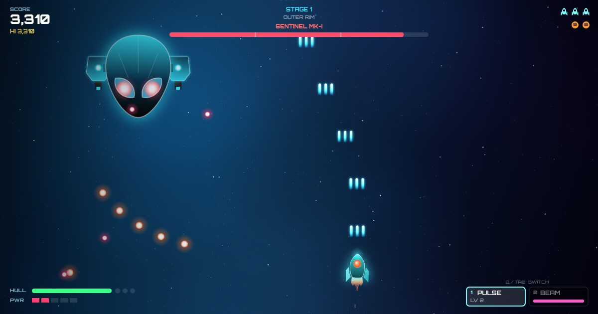

# Nova Strike: HTML5 Space Shooter Game in JavaScript

**A free browser space shooter (shoot 'em up) built from scratch with vanilla JavaScript, HTML5 Canvas and the Web Audio API.** It has no game engine, no framework and no build step.

### 🎮 [Play it live](https://arindamad.github.io/fighting-game/)




---

## About the game

Nova Strike is an arcade **2D spaceship shooting game** that runs in any modern desktop or mobile browser. You fly through 5 sectors, fight scripted enemy formations that **fire back**, switch between **two laser weapons** and take on a multi-phase **boss fight** at the end of every level. It plays like the classic arcade shmups (Galaga, Raiden, bullet hell games), rebuilt for the web.

### Features
- **Two laser weapons**
  - **Pulse Laser**: rapid-fire bolts that upgrade to Lv 5: wider spread shots, then **homing missiles** from Lv 4.
  - **Plasma Beam**: a continuous beam that pierces every enemy in line and **erases enemy bullets**. It drains energy and overheats if you empty it.
- **Enemies that fire back**: aimed shots, 3-way spreads, burst cannons, bullet rings and spiral bullet patterns.
- **Level design**: 5 themed sectors with 7 waves each. Enemies arrive in lines, V formations, snake chains, swoops, columns and dive-bomb runs.
- **Boss battles**: each boss has 3 attack phases and gets angrier as it loses health.
- **Score systems**: combo multiplier up to x5, bullet grazing, formation bonuses and a no-damage stage bonus.
- **Power-ups**: weapon power, shield, energy, hull repair, nova bomb and extra ship.
- **Procedural audio**: every sound effect and the soundtrack are generated in real time with the Web Audio API. The music speeds up during boss fights.
- **Game feel**: particle explosions, screen shake, hit-stop slow motion, hit flashes and warp-speed stage intros.
- **Online leaderboard** stored in Firebase Realtime Database.
- **Keyboard shortcuts**, plus mouse and touch-screen controls.

## Controls

| Action | Keys |
| --- | --- |
| Move | `W A S D` / arrow keys (or the mouse) |
| Fire (hold) | `Space` / `J` / left click |
| Switch laser | `Q` / `Tab` / mouse wheel |
| Pick Pulse / Beam | `1` / `2` |
| Nova bomb | `B` / `X` / right click |
| Precision movement | hold `Shift` |
| Pause | `P` / `Esc` |
| Restart / Quit (when paused) | `R` / `T` |
| Sound / Music / Fullscreen | `M` / `N` / `F` |

On mobile, drag to move (the ship fires automatically). Tap with two fingers to drop a bomb.

---

## Technical highlights (for developers and recruiters)

This project shows game development and frontend engineering skills without leaning on a library:

| Area | Implementation |
| --- | --- |
| **Rendering** | HTML5 Canvas 2D at the screen's pixel density, with sprites pre-rendered to offscreen canvases (glow baked in) and additive blending for lasers and particles |
| **Game loop** | `requestAnimationFrame` with delta time, frame-rate-independent physics and a time-scale for slow-motion effects |
| **Level design** | A data-driven wave system: levels are declared as formation builders (`line`, `vee`, `snake`, `swoop`, `divers`…) that scale to any screen size |
| **Enemy AI** | Movement along paths (cubic Bézier swoops, sine weaves, strafing, aimed dives) plus a separate pattern for each enemy's shots |
| **Boss design** | Health-based phase changes with spiral, fan, ring and burst bullet patterns, and reinforcement spawns |
| **Collision** | Circle collision, small player hitbox, grazing detection, and beam-vs-bullet cancellation |
| **Audio** | A Web Audio synth engine (oscillators, filtered noise, envelopes, compressor) and a look-ahead step sequencer that plays procedural music |
| **Performance** | In-place array compaction, cached sprites, capped particle counts |
| **Backend** | Firebase Realtime Database leaderboard with XSS-safe rendering |
| **UX** | Responsive layout, fullscreen, auto-pause when the tab loses focus, saved settings and high score |

### Project structure
```
index.html        Game shell, overlays, SEO metadata
css/app.css       UI / overlay styling
js/game.js        Game engine: rendering, entities, AI, levels, HUD
js/audio.js       Web Audio sound effects and procedural music
js/form.js        Firebase leaderboard
```

### Run locally
```bash
git clone https://github.com/arindamad/fighting-game.git
cd fighting-game
# open index.html in a browser, or serve it:
npx serve .
```
Tip: add `?stage=3` to the URL to jump straight to a later level.

---

## About the developer

Built by **[Arindam Sarkar](https://github.com/arindamad)**, a frontend and JavaScript game developer who enjoys building interactive, high-performance experiences for the web: **HTML5 games, canvas animation, interactive UI and real-time apps**.

💼 **Open to opportunities** as a JavaScript / HTML5 game developer or frontend developer. Feel free to reach out through my [GitHub profile](https://github.com/arindamad).

If you enjoyed the game, please ⭐ **star this repository**. It helps other people find it.

---

<sub>Keywords: HTML5 space shooter game, JavaScript game, browser game, canvas game, shoot em up, shmup, bullet hell, arcade game, spaceship shooting game, laser game, 2D game development, Web Audio API, Firebase, vanilla JS, game developer portfolio, frontend developer portfolio.</sub>
